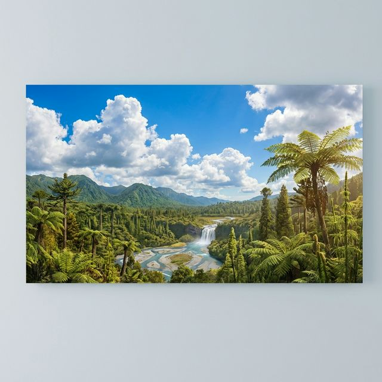

# 🌋 Vulkan Entdecker

Eine interaktive 3D-Lernanwendung zur Erkundung des Aufbaus und der Dynamik eines Vulkans im Webbrowser.



## ✨ Features

- **Interaktives 3D-Modell (Three.js & WebGL):**
  - Freie 360°-Kamerabewegung (Drehen, Zoomen, Schwenken).
  - Nahtloser Übergang zwischen Außenansicht und detailliertem Querschnitt bei Annäherung der Kamera.
- **Interaktive Hotspots & Lernstationen:**
  - Magmakammer
  - Hauptschlot & Seitenkrater
  - Krater & Vulkankegel
  - Asche- und Lavaschichten
  - Integrierte Forscher-Erklärungen (Forscher Tom).
- **Physikbasierte Eruptionssimulation:**
  - Realistische Partikelsysteme für Lavafontänen, herabfließende Lavaströme und aufsteigende Aschewolken.
  - Interaktiver Eruptions-Button mit Licht- und Sound-Atmosphäre.
- **Adaptiver Lite-Modus (2D-Fallback):**
  - Automatisches Umschalten für rechenschwächere Mobilgeräte und Tablets.
  - Manueller Schalter (3D / Lite) in der Kopfzeile.
- **Cinematische Benutzeroberfläche:**
  - Modernes Glassmorphism-Design.
  - Atmosphärischer Videohintergrund mit Steuerungsoptionen.

---

## 🚀 Schnellanleitung (Lokal starten)

Da moderne Browser aus Sicherheitsgründen (CORS & Web-Worker für 3D-Modelle) lokale Dateizugriffe (`file://`) einschränken, benötigt die Anwendung einen lokalen HTTP-Server.

### macOS
Führe einfach das Start-Skript per Doppelklick im Finder oder im Terminal aus:
```bash
./Start.command
```
*Oder manuell:*
```bash
python3 -m http.server 8080
```
Öffne anschließend [http://localhost:8080](http://localhost:8080) im Browser.

### Windows
Führe die Datei per Doppelklick aus:
```cmd
Start.bat
```
*Oder manuell in der Eingabeaufforderung:*
```cmd
python -m http.server 8080
```
Öffne anschließend [http://localhost:8080](http://localhost:8080) im Browser.

---

## 🛠️ Technologien

- **Rendering:** [Three.js](https://threejs.org/) (WebGL / GLTF Loader / DRACOLoader / OrbitControls)
- **Logik:** Modernes natives JavaScript (ES6 Modules)
- **Styling:** CSS3 (Flexbox/Grid, Custom Properties, Glassmorphism, Responsive Breakpoints)
- **Schriften:** Google Fonts (*Bebas Neue*, *Montserrat*)

---

## 📦 Releases & Deployment

Zum Erstellen eines Release-Archivs oder zur Veröffentlichung auf GitHub steht das Skript `deploy_release.sh` bereit:

```bash
# Release-Paket lokal erstellen (dist/Vulkan-Entdecker-v1.0.0.zip):
./deploy_release.sh --package

# Optional: Direkt auf GitHub veröffentlichen (erfordert gh CLI):
./deploy_release.sh --release v1.0.0
```

---

## 📄 Lizenz

Dieses Projekt ist unter der [MIT-Lizenz](LICENSE) lizenziert.
